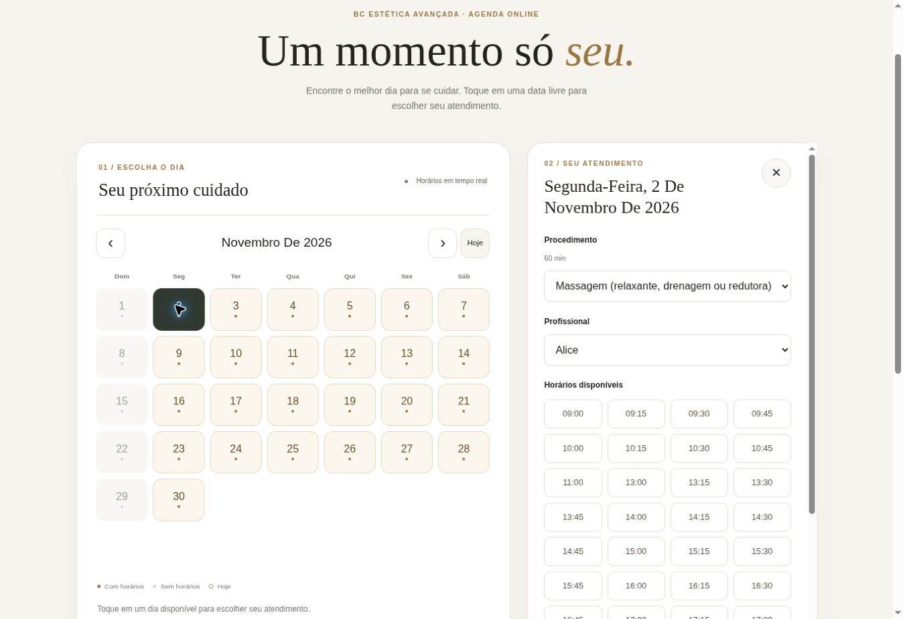

# Calendário mensal público — 17/10/2026

Calendário em destaque, com escolha do dia antes do procedimento e painel de atendimento por toque. Celular: painel inferior; tablet: modal central; desktop: painel lateral. Setas de mês e Hoje. Janela civil de consulta e reserva: mês atual até +12 meses inclusive, fuso America/Sao_Paulo.

## Código e verificações

- [PR #47](https://github.com/bcesteticaavancada/bcesteticaavancada-alt/pull/47) integrado em `3ea60f30bd7201f32faf5ae2202deedc2ebea412`.
- 708 testes Node: 62 pré-anamnese, 114 site e 532 gestão. Incluem 12 testes do fluxo com DOM real: erros recuperáveis, respostas obsoletas, conflito e submit duplicado.
- [Agenda DB CI 39028953188](https://github.com/bcesteticaavancada/bcesteticaavancada-alt/actions/runs/39028953188): 68 migrations, 205 assertions pgTAP em seis arquivos, lint aprovado, Advisors sem WARN e seis cenários concorrentes aprovados.
- [Site CI 39028953192](https://github.com/bcesteticaavancada/bcesteticaavancada-alt/actions/runs/39028953192) e [Pré-anamnese CI 39028953207](https://github.com/bcesteticaavancada/bcesteticaavancada-alt/actions/runs/39028953207): aprovados.
- Chromium e WebKit: 320, 390, 768, 1024 e 1440px; navegação futura, modal nativo, horários, confirmação fictícia, ausência de overflow horizontal e troca de breakpoint com painel aberto. Chamadas interceptadas; nenhuma reserva hospedada criada. Vinte capturas no artefato `agenda-browser-screenshots` do Site CI.
- Revisão independente identificou e validou correções de recuperação do catálogo após falha, respostas atrasadas, foco e modo modal ao redimensionar.

Na conferência da página publicada foi detectado HTML novo com módulos antigos retidos no cache. O [PR #48](https://github.com/bcesteticaavancada/bcesteticaavancada-alt/pull/48) versiona a folha de estilos, o módulo de entrada e suas dependências. O teste de navegador simula conteúdo legado nas URLs sem versão. A atualização não depende de limpar manualmente o armazenamento do app.

Frontend publicado e conferido em Chrome remoto. [PR #48](https://github.com/bcesteticaavancada/bcesteticaavancada-alt/pull/48) integrado em `e39d1a605a3b670fe921cec1ca577b287d9d749e`. [Deploy Pages 39029660650](https://github.com/bcesteticaavancada/bcesteticaavancada-alt/actions/runs/39029660650) e [Pages 39029660403](https://github.com/bcesteticaavancada/bcesteticaavancada-alt/actions/runs/39029660403): success.

[Site CI do ajuste 39029517624](https://github.com/bcesteticaavancada/bcesteticaavancada-alt/actions/runs/39029517624) e [Pré-anamnese 39029517710](https://github.com/bcesteticaavancada/bcesteticaavancada-alt/actions/runs/39029517710): success, incluindo novamente os dez cenários Chromium/WebKit com URLs legadas no servidor de teste.

No site sem login, o calendário carregou antes do procedimento; avançou para novembro; o toque em 02/11/2026 abriu o painel; Massagem exibiu Alice/Mel e Alice mostrou 30 inícios de 09h a 18h, com pausa respeitada. Campos pessoais mantidos vazios, nenhuma confirmação enviada. A página está no escopo do PWA.

## Banco e backend hospedados

Projeto `bc-estetica-gestao` / `tpqsmerlxquyrzrjbogj`. Histórico conferido antes da aplicação; as seis migrations anteriores já estavam presentes. Não houve repair, renomeação nem replay do histórico hospedado.

| Item | Resultado |
| --- | --- |
| Migration local adicional | `20261017111622_bc_public_agenda_month_overview.sql` |
| Versão hospedada | `20261017113420`, nome `bc_public_agenda_month_overview` |
| Edge Function | `public-agenda`, ACTIVE, versão 2; configuração pública anterior `verify_jwt=false` preservada |
| RPC overview | Somente data/booleano; execute para service_role, negado a anon/authenticated |
| HTTP overview outubro/2026 | 200, 31 dias, 13 com disponibilidade |
| HTTP overview novembro/2026 | 200, 30 dias, 25 com disponibilidade |
| HTTP overview outubro/2027 | 200, 31 dias, 14 com disponibilidade existente |
| Month/slots futuros | 200; 02/11/2026, procedimento 60 min: 30 inícios, 09h até 18h |
| Almoço e encerramento | Nenhum horário sobrepõe 12h–13h nem termina após 19h |
| Mês passado / +13 | HTTP 422 |
| Catálogo / profissionais | 30 procedimentos; Alice e Mel disponíveis segundo suas permissões |
| Performance Advisor hospedado | Zero WARN/ERROR; recomendações INFO históricas preservadas |

O endpoint `overview` consulta uma RPC restrita ao backend. Um dia livre exige slot real de procedimento publicado e profissional autorizado. No painel, somente profissionais com horários efetivos para procedimento/dia aparecem. As restrições de RLS, bloqueios, duração, conflitos e rate limiting continuam sendo verificadas na confirmação.

Nenhuma disponibilidade, conta, cliente ou reserva foi criada por esta migration. Inventário antes/depois desta etapa: cinco clientes, dois agendamentos existentes, zero atendimentos, 628 disponibilidades e 628 pausas. Não foram lidos nem modificados dados clínicos para a verificação. Consultas públicas retornaram apenas os DTOs permitidos.

## Recuperação

As três definições hospedadas substituídas foram preservadas em `scripts/operations/agenda-month-overview-rollback.sql` antes do rollout. Para reversão, restaurar primeiro frontend/Edge anteriores; depois executar o script transacional que restaura as definições e remove somente RPC/helper/índice adicionados. Nenhum cliente ou agendamento é removido. Não executar o rollback durante o deploy normal.

A normalização do histórico usada pelo CI continua exclusiva do ambiente descartável.

## Limites e configuração restante

- O app usa as mesmas páginas do site dentro do PWA. Testes em Chromium/WebKit com tamanhos de celular/tablet não equivalem a homologação em aparelhos Android/iPhone físicos ou PWA instalada.
- Não foi feita reserva fictícia na produção. O ciclo de escrita foi validado no banco descartável e no navegador com backend interceptado.
- Horários materializados até 16/10/2027; dias posteriores permanecem sem vagas até renovação operacional.
- E-mails de Aline e Kátia recebidos. As contas Auth ainda não existem; o painel de criação requer login do responsável. Não foi enviada mensagem/convite nem criada senha. Depois dos acessos, aplicar os mesmos turnos, Aline em pele sem botox/preenchimento e Kátia em massagens/drenagens, com papel colaborador sem administração.
- Revisão de segurança da pré-anamnese/Auth continua separada deste rollout.
